# Glossy Slate for Rockbox - iPod Classic 6G

<div align="center">
  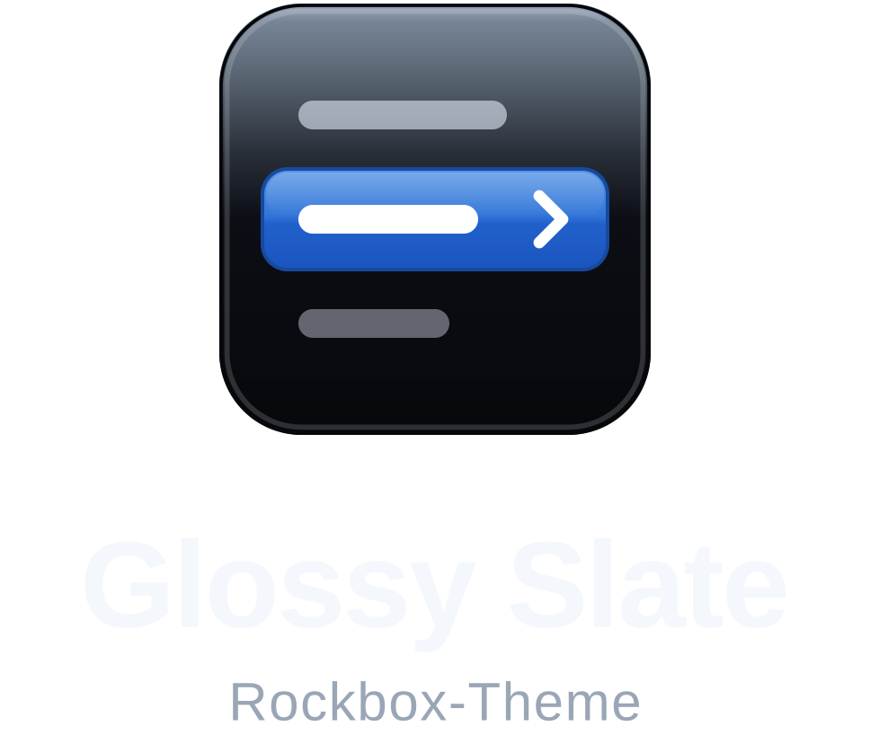
</div>

Glossy Slate is a theme for the iPod Classic (6th generation) together with
the modified Rockbox firmware it is built for. The theme uses features that
only exist in this fork (new skin tags, list rendering, popups, database
categories), so the two belong together.

> **Only for the iPod Classic 6G running this fork.** The theme does not work
> with stock Rockbox, and the firmware is built and tested for the Rockbox
> target `ipod6g` only. Use at your own risk and keep a backup of your
> iPod's contents.

<table>
  <tr>
    <td align="center" width="33%">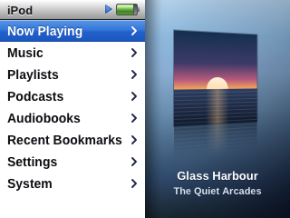</td>
    <td align="center" width="33%">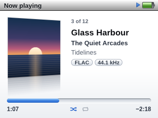</td>
    <td align="center" width="33%">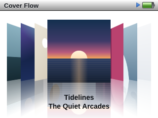</td>
  </tr>
  <tr>
    <td align="center"><b>Main menu</b> with the mini player of the playing track</td>
    <td align="center"><b>Now playing</b> with the tilted cover and its reflection</td>
    <td align="center"><b>Cover Flow</b> after the original iPod</td>
  </tr>
</table>

All screenshots show fictitious music. They are in `GlossySlate/screenshots/`;
the previews of the skin simulator (`GlossySlate/tools/preview.py`) are in
`GlossySlate/previews/`.

## What is in this repository

| Path | Content |
| --- | --- |
| `GlossySlate/.rockbox/` | The theme: status bar skin, now playing skin, bitmaps, fonts, theme config |
| `GlossySlate/tools/` | The tools that generate the theme's skins, bitmaps and fonts, and the previews |
| `GlossySlate/screenshots/` | The screenshots of this page |
| `GlossySlate/DESIGN.md`, `ROCKBOX-CHANGES.md` | Design specification and what the theme needs from the firmware |
| `apps/`, `firmware/`, `lib/`, … | Rockbox with the changes of this fork |
| `docs/ipod6g-*.md` | Developer notes on every change of the fork if you want to adjust the firmware further for your needs|

The fork is based on Rockbox commit `41a3e60b9c`. All changes for the iPod
are guarded by `IPOD_6G` in the source.

## Features

### Theme

- Two-column menus: list on the left, a sidebar on the right with a symbol,
  the title and a count for the selected entry (albums, podcasts,
  audiobooks, playlists, bookmarks, recordings, shortcuts).

<table>
  <tr>
    <td align="center" width="33%">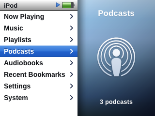</td>
    <td align="center" width="33%">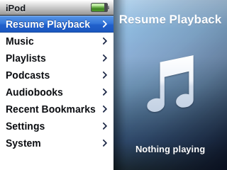</td>
    <td align="center" width="33%">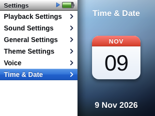</td>
  </tr>
  <tr>
    <td align="center">The sidebar shows the symbol and the count of the selected entry (here: 3 podcasts)</td>
    <td align="center">When nothing is playing, "Resume Playback" shows the note and "Nothing playing"</td>
    <td align="center">"Time &amp; Date" shows a calendar card with today's date</td>
  </tr>
</table>

- Glossy selection bar, list arrows, values on the right of setting rows,
  an overlay scrollbar that fades out.

<table>
  <tr>
    <td align="center" width="50%">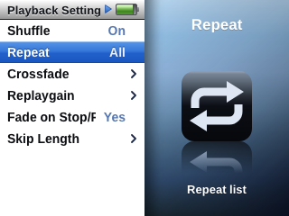</td>
    <td align="center" width="50%">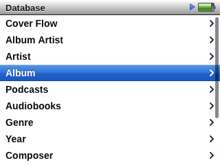</td>
  </tr>
  <tr>
    <td align="center">Settings with their values in the row (Shuffle On, Repeat All) and the tile of the selected entry in the sidebar</td>
    <td align="center">Long lists over the full width, with arrows and the scrollbar that fades out</td>
  </tr>
</table>

- Now playing screen with a tilted album cover, reflection and rounded
  corners (optional), track number, title, artist, album and format.

<table>
  <tr>
    <td align="center" width="100%"></td>
  </tr>
  <tr>
    <td align="center">Now playing with the tilted cover and its reflection</td>
  </tr>
</table>

- Lock screen with clock, quick menu for volume, brightness, shuffle and
  repeat, USB screens for "connected" and "ejected".

<table>
  <tr>
    <td align="center" width="33%">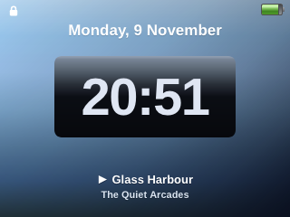</td>
    <td align="center" width="33%">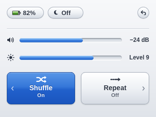</td>
    <td align="center" width="33%">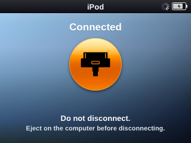</td>
  </tr>
  <tr>
    <td align="center">Lock screen with the date, the clock and the playing title</td>
    <td align="center">Quick menu: volume, brightness, shuffle and repeat</td>
    <td align="center">USB mode with the black status bar like the original iPod</td>
  </tr>
</table>

- Fonts "GlossySlate Sans", rendered from Liberation Sans 2.

### Firmware

- **Podcasts and audiobooks** as their own database categories, read from
  `/Podcasts` and `/Audiobooks` (one folder per podcast or audiobook). Music
  comes from `/Music` (or `/Musik`) only.
- **Heard status:** a blue dot marks podcast episodes and audiobook chapters
  not yet played for 15 seconds; "Mark as Unheard" resets a track or a
  whole podcast/audiobook (and its bookmark).
- **Automatic bookmarks** for podcasts and audiobooks: one per podcast or
  audiobook, written on stop and used when the bookmarked track is started
  again from the database.
- **Album list with covers** and a speaker icon at the playing track in all
  lists.

<table>
  <tr>
    <td align="center" width="50%">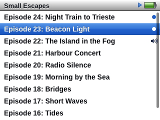</td>
    <td align="center" width="50%">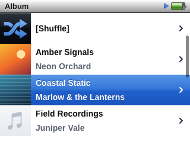</td>
  </tr>
  <tr>
    <td align="center">Episodes of a podcast: the blue dot marks episodes not yet heard, the speaker the one playing</td>
    <td align="center">Album list with covers, the entry "[Shuffle]" and the default cover for albums without a picture</td>
  </tr>
</table>

- **Fast scrolling:** turning the wheel fast in a list of the database
  (artists, albums, podcasts, audiobooks …) shows a square popup with the
  initial of the selected entry, as on the original iPod. From then on the
  popup stays and the wheel goes through the letters, while the list behind
  it jumps to the first entry of each letter; 2 s after the last turn the
  popup goes. Cover Flow does the same with the covers (by artist or album
  name, as the albums are sorted).

- **Cover Flow after the original iPod (RetailOS):** the first entry of the
  database opens Cover Flow (Rockpod's Cover Flow, in the colours of the
  theme and below its status bar, with smooth animations whose speed can be
  set). Selecting an album turns its cover to the left, and its back shows
  the album's tracks in the Glossy Slate style: album and artist in a blue
  header, up to seven titles with their length, the glossy selection bar,
  the fading scrollbar and the speaker at the playing track. The other
  covers stay visible around it; Menu turns the cover back. Albums without
  a picture show the theme's default cover.

<table>
  <tr>
    <td align="center" width="100%">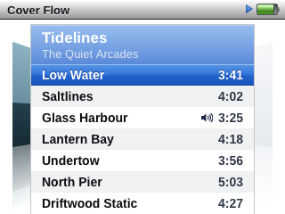</td>
  </tr>
  <tr>
    <td align="center">The back of the cover lists the album's tracks; the other covers stay visible around it</td>
  </tr>
</table>

- **Popups** drawn as glossy panels with shadows (messages, progress,
  yes/no with "Center button" / "Other button").
- **USB:** a second screen once the computer has ejected the drive.
- **Headset remote** with double and triple clicks (can be switched off).
- **Boot screen** over the whole display with the Rockbox logo; the version
  is written below it at start.
- Backlight fade-out, battery gauge that does not jump when the charger is
  plugged in or out and reads 100 % after a full charge, click-free
  switching of the sample rate, a fix for a file system race that could put
  the data of one file into another one.
- **Translatable theme:** every text the theme draws itself (counts in the
  sidebar, USB screens, lock screen date, quick menu …) comes from the
  language files. A new skin tag `%cD` writes dates in the words and order
  of the language ("Monday, 9 November", "Montag, 9. November",
  "lunes, 9 de noviembre").
- Languages: German, English, English (US) and Spanish carry the new texts;
  other languages show them in English.

## Installation

A more detailed installation readme can be found [here](GlossySlate/README.md).

1. **Bootloader:** install the Rockbox bootloader for the iPod Classic as
   described in the [Rockbox](https://www.rockbox.org/) manual.
2. **Firmware & Theme:** build the firmware yourself or unzip the latest release
    into the root of the iPod. The release also contains the theme. Copy the contents
    of `GlossySlate/.rockbox/` into the iPod's `/.rockbox/` folder. On the iPod choose
    *Settings › Theme Settings › Browse Theme Files › glossyslate*.
4. **Music:** put music into `/Music`, podcasts into `/Podcasts/<podcast>/`
   and audiobooks into `/Audiobooks/<audiobook>/`, then build the database
   (*Main Menu › Music (hold center button) › Initialize Now*). Loading the
   database into RAM is recommended.

The theme follows the language set on the iPod (*Settings › General
Settings › Language*).

## Building

The firmware is built like stock Rockbox, with the Rockbox ARM toolchain
(`tools/rockboxdev.sh`):

```sh
mkdir build && cd build
../tools/configure      # target: iPod Classic (ipod6g), build type: normal
make -j"$(nproc)"
make zip                # rockbox.zip
```

The theme's tools in `GlossySlate/tools/` need Python 3, Pillow, NumPy,
fontTools and Playwright with Chromium (the previews need only Pillow and
NumPy). Generated files are only changed through these tools;
`GlossySlate/DESIGN.md` (section 8.4) describes the order of the steps.

## Credits

This work would not have been possible without these projects:

- **[Rockbox](https://github.com/Rockbox/rockbox)** – the open source
  firmware this fork is built on, and everyone who has worked on it over the
  years.
- **[adwaitapod](https://github.com/D0-0K/adwaitapod)** by D0-0K – the
  Rockbox theme for the iPod Classic that Glossy Slate grew out of.
- **[Rockpod](https://github.com/nuxcodes/rockpod)** by nuxcodes – a Rockbox
  fork for the iPod Classic and Video that showed what a modern Rockbox on
  the iPod can be and was a reference for this fork; its Cover Flow is the
  base of the Cover Flow here.

The fonts are derived from Liberation Sans 2 (SIL Open Font License 1.1).

## License

- Rockbox and the changes of this fork: GNU General Public License,
  version 2 or later (`docs/COPYING`).
- The Glossy Slate theme (`GlossySlate/`): GNU General Public License,
  version 3 or later, as it builds on adwaitapod (GPL-3.0).
- The fonts in `GlossySlate/.rockbox/fonts/`: SIL Open Font License 1.1
  (`GlossySlate-OFL.txt`). "Liberation" is a reserved font name, so the
  fonts are called GlossySlate.

iPod is a trademark of Apple Inc. This project is not affiliated with or
endorsed by Apple.
